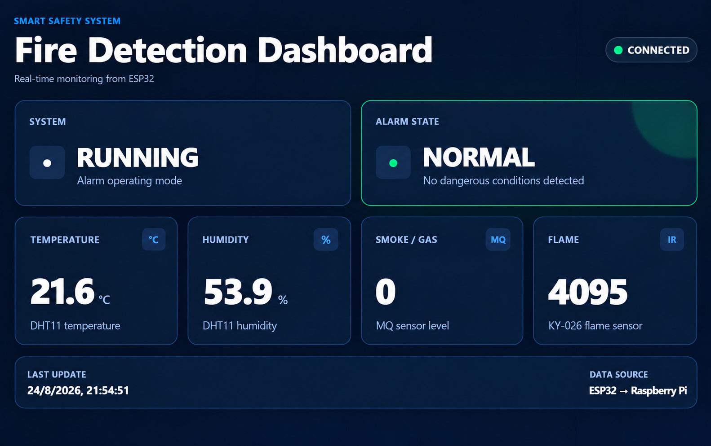
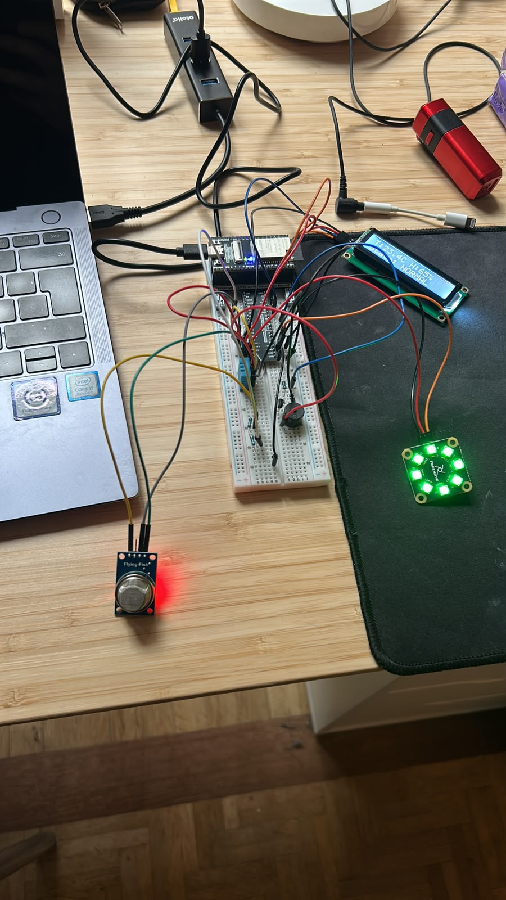
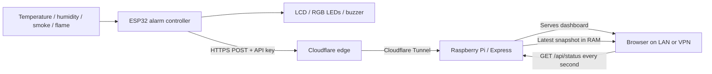

<div align="center">
  <h1>Smart Fire Detection &amp; Remote Monitoring</h1>
  <p><strong>Local fire detection. Secure remote visibility.</strong></p>
  <p>An ESP32 alarm prototype with a Raspberry Pi dashboard and HTTPS telemetry.</p>
  <p>
    
    
    
    
    
    
  </p>
  <p>
    <a href="#overview">Overview</a> ·
    <a href="#dashboard-preview">Dashboard preview</a> ·
    <a href="#physical-prototype">Physical prototype</a> ·
    <a href="#project-report">Project report</a> ·
    <a href="#architecture">Architecture</a> ·
    <a href="#hardware">Hardware</a> ·
    <a href="#getting-started">Getting started</a> ·
    <a href="#security-and-safety">Security &amp; safety</a>
  </p>
</div>

## Overview

This project combines an autonomous ESP32 fire-detection prototype with a Raspberry Pi monitoring server. The ESP32 reads temperature, humidity, smoke/gas, and flame sensors, evaluates alarm states locally, and drives an LCD, RGB LEDs, and a buzzer. It sends telemetry to the Raspberry Pi over HTTPS; a browser dashboard displays the latest readings and connection state.

> **Prototype only:** this project is educational and is not a certified fire alarm or life-safety device. Its sensor thresholds require calibration. Do not rely on it for fire protection.

## Dashboard Preview

[](docs/screenshots/fire-detection-dashboard-enhanced.png)

*Dashboard snapshot. The displayed sensor readings are captured values, not live telemetry.*

## Physical Prototype

<p align="center">
  <a href="docs/images/alarm-prototype.jpeg">
    
  </a>
</p>

The physical breadboard prototype brings together the ESP32, sensors, LCD, RGB status lighting and local alarm circuitry. This is an educational prototype, not a certified fire-safety device.

## Project Report

**[Read the Project Delivery Report (PDF, 11 pages)](docs/reports/Smart_Fire_Detection_Delivery_Report.pdf)**

The report explains the project objectives, hardware, modular firmware, Raspberry Pi dashboard, network architecture, security controls, testing, design decisions and remaining limitations.

## At A Glance

| State | Meaning | RGB indicator | Buzzer |
| --- | --- | --- | --- |
| `NORMAL` | No configured threshold exceeded | Green | Off |
| `WARNING` | One or more warning thresholds exceeded | Yellow | Off |
| `CRITICAL` | A critical threshold exceeded | Red | On |
| `OFF` | Sensor evaluation disabled by the physical switch | Off | Off |

Alarm-state decisions and local outputs are handled by the ESP32. The Raspberry Pi receives and displays telemetry; it does not determine the alarm state.

## Architecture



The ESP32 sends telemetry immediately when its state changes and sends a heartbeat every 10 seconds. The dashboard polls the Raspberry Pi once per second. The server keeps only the latest readings in memory; it does not use a database or retain historical data. When an `OFF` message arrives, the server updates the mode and timestamp while preserving the last sensor readings.

## Hardware

| Component | ESP32 connection | Role |
| --- | --- | --- |
| DHT11 | GPIO 13 | Temperature and humidity |
| MQ smoke/gas module | GPIO 34 (ADC1) | Analog smoke/gas level |
| KY-026 flame sensor | GPIO 35 (ADC1) | Analog flame/IR response |
| 16x2 I²C LCD | SDA 21, SCL 22 | Local readings and state |
| 8-LED WS2812 module | GPIO 2 | State color |
| Active buzzer | GPIO 18 through S8050 transistor | Critical-state alert |
| Slide switch | GPIO 19 (`INPUT_PULLUP`) | Enable or disable sensing |

Condition analog sensor outputs to the ESP32's safe input range before connecting them. The buzzer is switched through the S8050 transistor; do not drive its load directly from an ESP32 GPIO.

### Firmware Thresholds

Prototype values are defined in `arduino-code/config.h`:

| Sensor | Warning | Critical |
| --- | ---: | ---: |
| Temperature | ≥ 25 °C | ≥ 27 °C |
| Smoke/gas ADC | ≥ 20 | ≥ 60 |
| Flame ADC | < 1500 | < 100 |

These values are experimental starting points, not validated fire-detection thresholds. Calibrate sensors in the final hardware setup before interpreting readings.

## Server API

The Express server listens on port `5000` by default.

| Method | Path | Access | Purpose |
| --- | --- | --- | --- |
| `POST` | `/api/status` | ESP32 telemetry through HTTPS; requires `X-API-Key` | Validate and store the latest reading in memory |
| `GET` | `/api/status` | Local network or VPN only | Return the current in-memory status |
| `GET` | `/` | Local network or VPN only | Serve the monitoring dashboard |

Example running telemetry:

```json
{
  "system": "RUNNING",
  "state": "NORMAL",
  "temperature": 24.3,
  "humidity": 52.0,
  "smoke": 18,
  "flame": 2150
}
```

The ESP32 sends an `OFF` payload with `system` and `state` set to `OFF`. The API key is sent in the `X-API-Key` request header, not in the JSON body.

## Getting Started

### Requirements

- Raspberry Pi or another Linux host on which the dashboard server can run
- Node.js 20 or newer and npm
- Arduino IDE with ESP32 board support
- ESP32 and the sensors/outputs listed above
- Arduino libraries: `DHTesp`, `LiquidCrystal_I2C`, and `Freenove_ESP32_WS2812`
- Cloudflare Tunnel for secure telemetry across networks

### 1. Start The Raspberry Pi Server

Clone the repository on the Raspberry Pi, install the locked dependencies, and create a local `.env` file:

```bash
git clone https://github.com/theblondcoder/alarm-smart-tech.git
cd alarm-smart-tech
npm ci
```

Create `.env` in the project root:

```dotenv
PORT=5000
ALARM_API_KEY=replace-with-a-long-random-secret
```

Generate a key, for example, with `openssl rand -hex 32`. Configure the same key in the ESP32 firmware. Start the server:

```bash
node app.js
```

The dashboard is served at `http://<raspberry-pi-address>:5000` on the local network. Keep it restricted to the local network or VPN.

### 2. Configure And Upload The ESP32 Firmware

The real firmware configuration is intentionally excluded from Git. Copy `arduino-code/secrets.example.h` to `arduino-code/secrets.h` on your computer, then fill in your own Wi-Fi SSID and password, the HTTPS telemetry URL, and the same API key configured in the server's `.env`. The telemetry URL should point to your Cloudflare HTTPS hostname and `/api/status`.

`arduino-code/secrets.h` is ignored by Git. Do not commit or share it. The firmware validates the TLS certificate using the public trusted CA in `arduino-code/certificates.h`.

Open `arduino-code/alarmSmartTech.ino` in Arduino IDE, select the ESP32 board and port, then compile and upload. Install the libraries listed under Requirements if they are not already available.

### 3. Configure Remote Telemetry

Run `cloudflared` on the Raspberry Pi and route the public HTTPS telemetry hostname through the tunnel to the Express server. Configure the public route for `POST /api/status` only. Keep the unauthenticated dashboard and `GET /api/status` reachable only from the LAN or VPN.

## Security And Safety

- HTTPS is used for ESP32 telemetry, and the firmware validates the server certificate.
- Telemetry `POST` requests require the shared `X-API-Key` header and are checked for valid states, types, and sensor ranges.
- Store the server key in the Raspberry Pi's untracked `.env` file and use the matching value in your local, ignored `arduino-code/secrets.h`. The repository contains only `arduino-code/secrets.example.h`, with placeholders. Never publish real Wi-Fi credentials, API keys, private hostnames, or local network addresses.
- The dashboard and `GET /api/status` do not require authentication; restrict them to a trusted local network or VPN.
- A Cloudflare Tunnel avoids opening an inbound router port, but its routing rules must not expose the whole dashboard publicly.
- This prototype is not certified for life-safety use.

## Validation And Limitations

The delivery report records component-level checks, combined alarm behavior, API-key rejection/acceptance, HTTPS certificate validation, Cloudflare Tunnel telemetry, and dashboard updates. The repository does not currently include an automated test suite.

Remaining work includes final sensor calibration, MQ sensor warm-up handling, filtering repeated noisy readings, and configuring the Node.js process to start automatically on Raspberry Pi. Server readings are intentionally in-memory and are lost when the process restarts. Remote OFF control is not implemented.

## Project Structure

```text
alarm-smart-tech/
|-- app.js                         # Raspberry Pi Express server and API
|-- public/                        # Static monitoring dashboard
`-- arduino-code/                  # Modular ESP32 firmware
    |-- alarmSmartTech.ino         # Main firmware loop
    |-- sensors.*                  # Sensor acquisition
    |-- system_state.*             # NORMAL / WARNING / CRITICAL logic
    |-- outputs.*                  # LCD, RGB LEDs, and buzzer
    `-- network.*                  # Wi-Fi and HTTPS telemetry
```

## Author

Ivan Baltanas Ortiz
